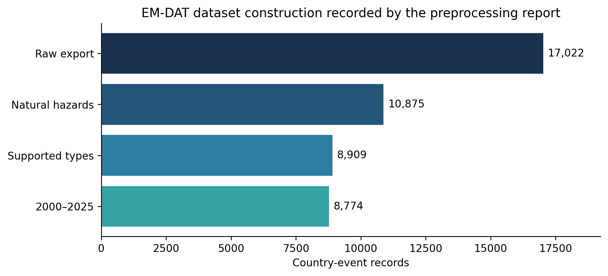
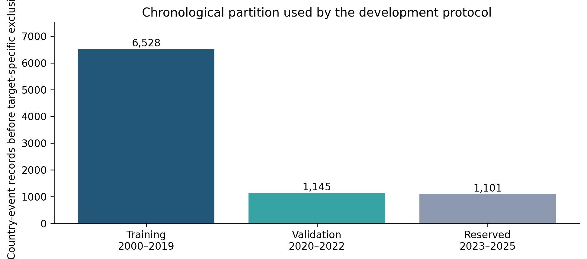
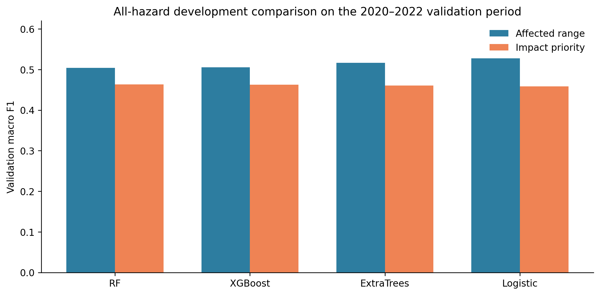
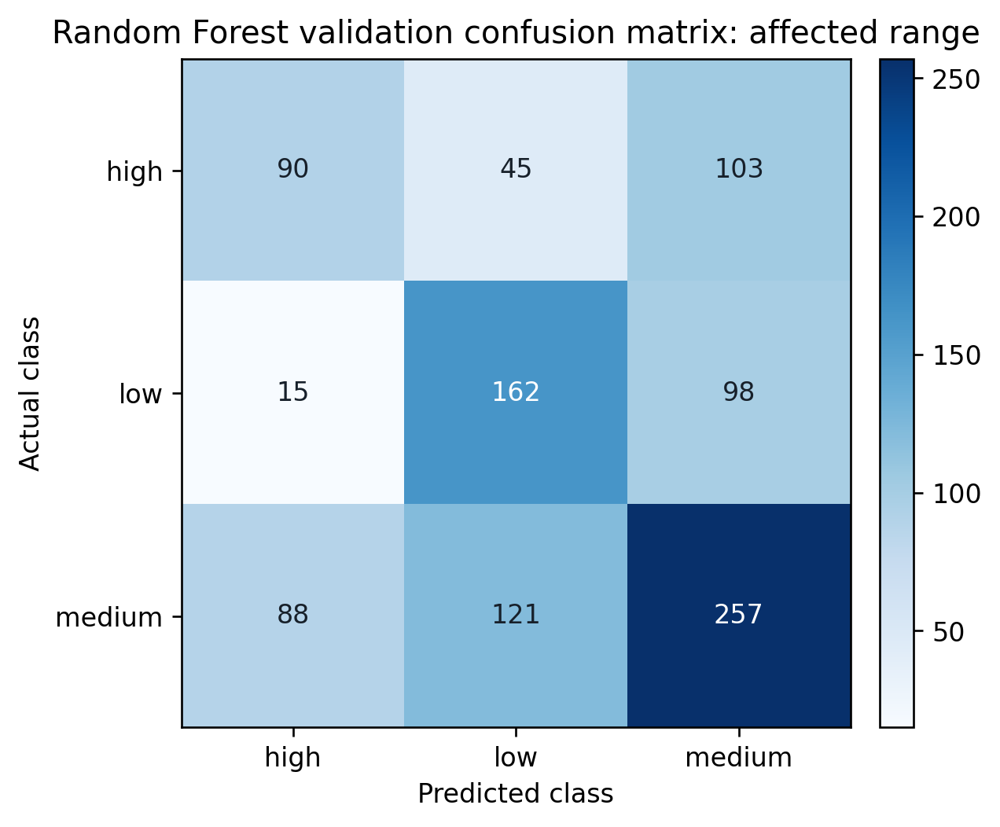
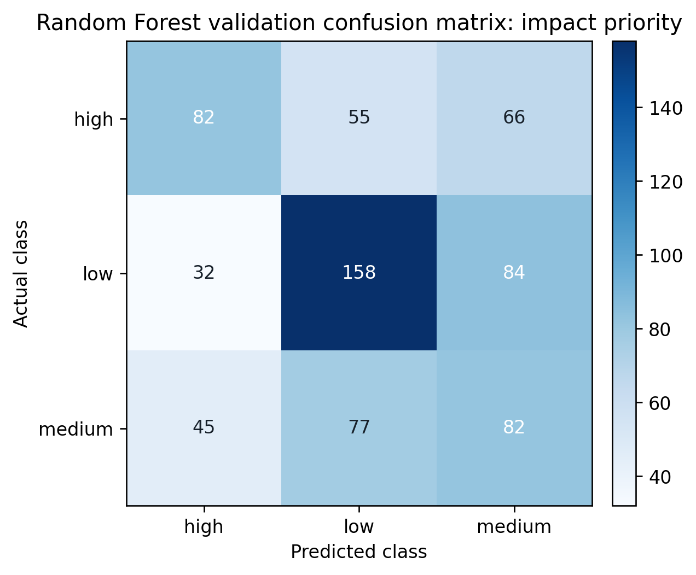

**Affiliation:** [Department, institution, city, country]

**Corresponding author:** [Name and email]

## Abstract

Disaster-impact models are often evaluated on retrospective records even when their intended use requires information available near event onset. This study presents a provenance-aware, temporally separated framework for classifying country-event disaster impacts while keeping historical modelling distinct from live event monitoring. An EM-DAT export was filtered to 8,774 country-event records from six natural-hazard categories during 2000–2025. Two three-class outcomes were constructed from training-period human-impact records: affected range, based on global quartiles of Total Affected, and impact priority, based on hazard-specific thresholds of Total Deaths and Total Affected. Models were developed on 2000–2019 records and compared on 2020–2022 records; 2023–2025 was excluded from development and no scores for that period are reported. The fixed nine-feature Random Forest achieved validation accuracy/macro F1 of 0.5199/0.5037 for affected range and 0.4728/0.4632 for impact priority, exceeding most-frequent baselines. Development comparisons with ExtraTrees, XGBoost, and regularized multinomial logistic regression produced modest differences rather than decisive gains. A separate cyclone workflow conservatively links EM-DAT country records to IBTrACS physical-storm identifiers, enforces storm-group separation, and restricts track features to observations at or before 00:00 UTC on the recorded start date. The repository lacks the local cyclone result artifacts required for independent numerical verification, so those results are not treated as publication findings. GDACS supports observational monitoring only; it is not presented as validated live impact inference. The study demonstrates reproducible task construction while exposing unresolved event dependence, reporting bias, feature-availability, and uncertainty.

**Keywords:** disaster impact classification; EM-DAT; IBTrACS; GDACS; temporal validation; event-aware evaluation; Random Forest; data leakage; provenance

## 1. Introduction

Machine learning is used across disaster preparedness, response, and recovery, but the phrase *disaster prediction* covers materially different tasks: hazard occurrence, susceptibility mapping, physical-intensity estimation, casualty or loss estimation, and operational resource decisions [4]. Each task has a different unit of analysis, prediction time, outcome definition, and acceptable source of evidence. A high score for a spatial susceptibility map cannot be transferred to country-event impact classification, and a retrospective impact model is not automatically a live forecast.

This study examines two historical classification tasks constructed from the Emergency Events Database (EM-DAT): an affected-population range and a hazard-relative impact-priority proxy. EM-DAT provides global country-event records and manually curated human and economic consequences [1]. Its broad coverage is valuable, but its outcomes are affected by reporting practices, revisions, and missingness [1,11]. These properties require careful target definitions and restrained interpretation.

The methodological motivation comes from two complementary publications. Delforge et al. [1] document EM-DAT's event inclusion rules, country-specific record structure, source monitoring, manual processing, and known data-quality limitations. Their work is a database description, not a predictive benchmark. Talan et al. [2] model adjusted economic losses with retrospective EM-DAT variables and explicitly group country records belonging to the same disaster event. They evaluate several ensembles under grouped, temporal, regional, and hazard holdouts. Their design demonstrates why a country-record identifier and a physical event are different statistical units. Their continuous monetary target, 21 predictors, and retrospective use of deaths, affected population, and end-date variables differ from the present three-class human-impact tasks; their reported errors therefore cannot be compared directly with the F1 scores in this study.

The project also investigates tropical-cyclone enrichment from NOAA's International Best Track Archive for Climate Stewardship (IBTrACS) [15] and maintains a separate Global Disaster Alert and Coordination System (GDACS) monitoring application. The separation is essential. IBTrACS is a retrospective best-track archive assembled from multiple agencies, whereas GDACS provides observational alert information. Neither source supplies verified EM-DAT outcome labels at alert time. The project consequently treats GDACS as monitoring evidence and never silently transforms its population exposure into observed affected population.

The research question is: **How do established structured-data classifiers perform on temporally later EM-DAT country-event records under explicit target construction, and what additional safeguards are required to study physical-cyclone features without overstating prospective validity?** The objective is methodological reliability rather than a predetermined performance threshold.

## 2. Literature Review and Research Gap

### 2.1 Multi-hazard assessment and disaster AI

Zhang et al. [3] combine Idaho hazard information and American Community Survey variables to classify regional flood, wildfire, seismic, and social-vulnerability levels. This is a useful conceptual precedent for analysing several hazard contexts in one framework, but its watershed/city units, indicator-derived outcomes, and repeated random splits differ from country-event human impacts. Pidurkar et al. [10] similarly use geospatial layers for local grid-level risk mapping. These studies assess spatial risk or susceptibility; they do not estimate the same outcome at the same time point as this study.

Reviews by Sun et al. [4], Albahri et al. [5], Liu et al. [8], and Gerolimos et al. [9] document the breadth of artificial intelligence applications and recurring concerns about trustworthiness, heterogeneous data, explanation, and operational context. The accessible evidence differs across these papers: Sun and Albahri were used within abstract-level scope, Liu only for bibliographically verified review scope, and Gerolimos through accessible full text. They support the need for transparent evaluation but do not provide a common numerical benchmark.

### 2.2 Event-level impacts and losses

Talan et al. [2] are the closest methodological comparator. They use 5,051 country records representing 4,519 events from EM-DAT (1975–2025), predict adjusted economic loss, and compare Random Forest, XGBoost, LightGBM, CatBoost, and baselines. Their event-grouped and strict temporal analyses are stronger safeguards against cross-country event leakage than a row-level random split. Their tuned CatBoost achieved event-grouped RMSLE 1.890 and log-scale (R^2=0.491), while the strict temporal analysis achieved RMSLE 1.791 and (R^2=0.464) [2]. These figures describe regression on a different target and cannot be interpreted as better or worse than the present macro F1.

Chen and Zhang [6] address earthquake casualty-rate and economic-loss prediction with automated machine learning, while Li et al. [14] estimate earthquake casualties in mainland China using physical and socioeconomic predictors. Akshay et al. [7] describe flood-damage severity classification, and Kalaivani et al. [13] describe multi-hazard severity and death prediction. Full methodological details were not accessible for every source, so they establish related task directions rather than exact baselines. Cross-paper accuracy comparisons would be misleading where labels, exclusions, predictors, hazards, and splits differ.

Aykut et al. [12] link GDACS earthquake alert variables to later mortality and field-hospital deployment. Their study is particularly relevant because it performs an explicit outcome linkage instead of assuming alert variables are equivalent to impacts. It does not validate the present target definitions or a live multi-hazard classifier.

### 2.3 Evaluation design

Temporal and grouped validation matter when samples share spatial, temporal, or hierarchical dependence [20]. Reusing a validation set for model selection can produce optimistic estimates [19,26], while small validation cohorts yield uncertain rankings [22]. Class-aware metrics are also necessary because overall accuracy can obscure weak minority-class behaviour [21]. These concerns motivate chronological partitioning, macro F1, per-class reporting, and physical-storm grouping in the cyclone workflow.

### 2.4 Defensible gap

The literature already contains spatial multi-hazard classification, single-hazard casualty prediction, global economic-loss modelling, and retrospective GDACS outcome analysis. The defensible gap is narrower: **a transparent comparison of two reproducibly constructed EM-DAT impact-class proxies under chronological development, coupled with an event-aware cyclone-enrichment protocol that audits prediction-time feature availability and preserves country-specific outcomes.** This is not a novel algorithm, a first-ever impact model, or evidence of operational superiority. Evaluation gaps in applied machine learning [23] and leakage failures [27] make this narrower contribution scientifically useful even when performance is modest.

## 3. Research Objectives and Contributions

The study has four objectives:

1. define affected-range and relative impact-priority labels from training-period outcomes without using those outcomes as predictors;
2. compare established structured-data models on a fixed chronological validation period and report class-sensitive metrics;
3. construct a conservative EM-DAT–IBTrACS linkage and cutoff policy that prevents post-onset track observations from entering cyclone features; and
4. document why GDACS monitoring is observational and remains separate from validated machine-learning inference.

The implemented contributions are the auditable preprocessing and experiment code, saved all-hazard validation artifacts, country-event/physical-storm safeguards, and provenance records. The work does not contribute a new learning algorithm or an expert-validated operational priority standard.

## 4. Datasets and Data Provenance

### 4.1 EM-DAT

The repository's preprocessing report identifies the source workbook as `public_emdat_2026-09-09.xlsx`. It records 17,022 raw rows, of which 10,875 are natural-disaster records, 8,909 belong to the supported types, and 8,774 remain after restricting years to 2000–2025. The retained categories are Earthquake, Flood, Landslide, Storm, Volcanic activity, and Wildfire. Wet and dry mass movements are normalized to Landslide.

{ width=88% }

EM-DAT standardizes data by disaster and country, so one physical disaster can yield several country records [1]. The report's absence of duplicate `DisNo.` values establishes identifier uniqueness within the processed rows, not physical-event independence. Jones et al. [11] show that missing human and economic outcomes in global disaster data are structured rather than necessarily random. Excluding records with unknown labels prevents fabricated outcomes but does not remove selection bias.

### 4.2 IBTrACS

IBTrACS consolidates tropical-cyclone best-track records across agencies [15]. The matching pipeline requires one unique supported storm identifier (SID), compatible geography, and verified date/track overlap. Country-date-only matches are not accepted as high confidence. A committed research checkpoint records 1,249 eligible EM-DAT cyclone country records, 608 high-confidence country matches, and 386 physical cyclones after grouping. These counts were generated locally from authentic files but cannot be independently recomputed in this environment because the raw sources and generated match audit are intentionally absent from Git.

Best-track fields can contain agency-dependent wind conventions and retrospective corrections. `WMO_WIND` missingness is preserved; no alternative agency wind is silently substituted. This archive therefore supports retrospective, cutoff-constrained experiments, not proof that every feature was published at the intended prediction time.

### 4.3 GDACS

The monitoring application retrieves the official GDACS RSS feed, stores saved events, and exposes them through FastAPI to a React/Leaflet interface. A separate local research collector archives original response bytes, hashes, retrieval metadata, and versioned tropical-cyclone XML. Retrieval time only proves that an archived version was observed by that time; publication or modification timestamps are not used to reconstruct earlier availability.

GDACS severity, alert score, modelled population exposure, vulnerability, coordinates, and repeated country occurrences retain source provenance and units where available. Population exposure, including `Pop74`, is modelled exposure and is neither EM-DAT Total Affected nor a training outcome. Current-event and archived-version displays are separated. No validated end-to-end GDACS impact prediction is claimed.

## 5. Methodology

### 5.1 Target construction

`affected_range` is defined where Total Affected is present. Training-period quartiles are (q_{25}=800.0) and (q_{75}=48{,}723.2). Records at or below (q_{25}) are low; records above (q_{25}) and at or below (q_{75}) are medium; records above (q_{75}) are high.

`impact_priority` requires non-missing Total Deaths and Total Affected. Within each hazard, medians and 75th percentiles are computed from training records only. A record is high if either outcome exceeds its corresponding 75th percentile, medium if either exceeds its median but neither exceeds its 75th percentile, and low otherwise. At least 30 complete training records are required. Volcanic activity has only 17 and therefore receives no priority label. This label is a hazard-relative historical proxy, not an official dispatch priority.

### 5.2 Predictors and preprocessing

The fixed baseline contains nine features. Categorical features are `disaster_type`, `disaster_subtype`, `iso`, `region`, `subregion`, and `season`; numeric features are `start_month`, `magnitude`, and `magnitude_available`. Season is a calendar grouping (DJF, MAM, JJA, SON), not a local climatic-season label. Magnitude units depend on hazard, and 5,705 of 8,774 retained records (65.0%) lack magnitude.

Categorical values are imputed with the training most-frequent value and one-hot encoded with unknown validation categories ignored. Numeric values are median-imputed using training rows. Missing magnitude is retained during dataset construction and only imputed inside the fitted pipeline; the accompanying availability flag remains a predictor. Outcome columns are never included in the feature matrix. The implementation uses scikit-learn pipelines [25].

### 5.3 Temporal design

The chronological protocol assigns 2000–2019 to training, 2020–2022 to validation, and 2023–2025 to a reserved period. Thresholds and preprocessing are derived only from training records. The reserved period is excluded from all comparisons in this manuscript, and no reserved-period scores are reported.

{ width=82% }

Target-specific labeled cohort sizes are 5,432 training and 979 validation records for affected range, and 3,961 training and 681 validation records for impact priority. Model comparisons for a target use the same corresponding rows.

### 5.4 Models and metrics

The original Random Forest uses 300 trees, balanced class weights, unrestricted depth, minimum leaf size 1, seed 42, and all CPU cores [16]. The most-frequent Dummy classifier is the baseline. Saved development experiments also compare ExtraTrees [17], XGBoost [18], and regularized multinomial logistic regression using the same nine inputs. Each non-Random-Forest family evaluates at most three preregistered configurations and identifies the highest validation macro F1. This identification is development selection, not an independent test.

Reported metrics are accuracy, macro F1, weighted F1, balanced accuracy, per-class precision/recall/F1/support, and confusion matrices. Balanced accuracy in the consolidated table is the arithmetic mean of the saved class recalls. Macro F1 is emphasized because it gives equal weight to each class; accuracy and weighted F1 remain supplementary [21,24].

### 5.5 Event-aware cyclone workflow

The cyclone pipeline retains one row per EM-DAT event-country record and its country-specific label. A physical SID groups related rows. SIDs spanning training and validation are rejected, preventing the same cyclone from appearing on both sides of the development boundary.

For complete EM-DAT start dates, (T_0) is defined as 00:00 UTC on that date. Only IBTrACS observations with `ISO_TIME <= T0` are eligible, and future interpolation is forbidden. The latest eligible location, WMO wind, WMO pressure, distance to land, reporting agency, storm age, and past-only motion are extracted with availability indicators. Motion requires two valid observations. Future extrema, landfall fields, full storm duration, deaths, affected counts, and damage are excluded.

The feature-block experiment defines: A, the nine EM-DAT predictors; B, A plus wind, pressure, agency, and availability indicators; and C, the full cutoff feature set. A separate magnitude ablation removes `magnitude` and `magnitude_available`. The algorithm experiment holds the nine features fixed across Random Forest, ExtraTrees, and XGBoost. Planned paired uncertainty intervals sample physical SIDs with replacement and preserve all country rows within a sampled SID. The scripts specify 2,000 replicates, seed 20261023, and fixed class order. Because the corresponding local JSON outputs are absent, these intervals and cyclone model comparisons are not reported as verified results.

## 6. Experimental Setup

All-hazard results were recovered from committed JSON artifacts and checked against their class reports and confusion matrices. Package versions recorded by the family experiments are Python 3.12.10, NumPy 2.5.3, pandas 3.0.5, scikit-learn 1.9.1, and XGBoost 3.4.1 where applicable. The original validation JSON does not itself record software versions; artifact hashes are listed in `results_provenance.md`.

The study does not rerun training in this environment because the licensed/raw workbook and processed dataset are absent. This means the paper verifies internal artifact consistency, not independent reproduction from source records. The manuscript deliberately excludes the repository's reserved-period result file because its execution authorization and chain of custody were not established during this review.

## 7. Results

### 7.1 Verified all-hazard validation

Table 1 reports the fixed baseline and the best saved development entry for each additional model family. Comparisons use the same target-specific all-hazard cohort, but the non-Random-Forest rows were chosen by validation macro F1 from small preregistered sets and must not be interpreted as independent performance estimates.

**Table 1. Verified 2020–2022 all-hazard validation results**

| Target | Model | Accuracy | Macro F1 | Weighted F1 | Balanced accuracy |
|---|---|---:|---:|---:|---:|
| Affected range | Dummy (most frequent) | 0.4760 | 0.2150 | 0.3070 | — |
| Affected range | Random Forest | 0.5199 | 0.5037 | 0.5172 | 0.5062 |
| Affected range | XGBoost | 0.5128 | 0.5058 | 0.5125 | 0.5144 |
| Affected range | ExtraTrees | 0.5240 | 0.5168 | 0.5228 | 0.5250 |
| Affected range | Logistic regression | 0.5342 | 0.5274 | 0.5339 | 0.5358 |
| Impact priority | Dummy (most frequent) | 0.2981 | 0.1531 | 0.1369 | — |
| Impact priority | Random Forest | 0.4728 | 0.4632 | 0.4732 | 0.4608 |
| Impact priority | XGBoost | 0.4802 | 0.4629 | 0.4741 | 0.4632 |
| Impact priority | ExtraTrees | 0.4670 | 0.4604 | 0.4696 | 0.4568 |
| Impact priority | Logistic regression | 0.4787 | 0.4586 | 0.4706 | 0.4599 |

The fixed Random Forest exceeds the Dummy baseline by 0.2887 macro-F1 points for affected range and 0.3101 for impact priority. Among development comparisons, affected-range scores vary modestly, with the selected logistic configuration reaching 0.5274 macro F1. Impact-priority macro F1 ranges from 0.4586 to 0.4632 across the four fitted families, showing no material algorithmic breakthrough.

{ width=92% }

### 7.2 Class-level behaviour

For affected range, the Random Forest recalls 90 of 238 high, 162 of 275 low, and 257 of 466 medium records. The largest high-class error is high predicted as medium (103 records). For impact priority, it recalls 82 of 203 high, 158 of 274 low, and 82 of 204 medium records. Medium is frequently confused with low (77) or high (45), and 66 high-priority records are predicted medium.

{ width=58% }

{ width=58% }

The gaps between accuracy and class-level recall reinforce why a single aggregate percentage is insufficient. The impact-priority medium class is particularly difficult, plausibly because it is defined by threshold combinations of two noisy outcomes rather than a directly observed operational decision.

### 7.3 Cyclone experiments: evidence status

The manuscript request supplied six local checkpoint values: nine-feature Random Forest macro F1 of 0.6161/0.4689, full IBTrACS macro F1 of 0.4067/0.3947, and no-magnitude macro F1 of 0.4668/0.5072 for affected range/impact priority, respectively. However, `v2_ibtracs_cyclone_validation.json`, the feature-block output, magnitude-ablation output, and algorithm-comparison output are absent from the checkout. Denominators, predictions, confusion matrices, cohort fingerprints, and paired bootstrap intervals therefore cannot be verified here. The values are quarantined in `tables/preliminary_cyclone_metrics_pending_verification.csv` and are not used as findings, figures, or model-selection evidence in this manuscript.

No verified cyclone ExtraTrees or XGBoost metric was recovered. This is missing evidence, not a negative result.

## 8. Discussion

### 8.1 What the verified results mean

The all-hazard models learn information beyond the training-majority baseline, but validation macro F1 remains approximately 0.46–0.53. The narrow spread among established algorithms suggests that representation and label limitations may dominate algorithm choice. The selected affected-range logistic model slightly exceeds the ensembles, but the same validation period selected it; an independent estimate is still required [19,26].

Impact priority is harder than affected range. It combines deaths and affected population through hazard-specific discontinuous thresholds, and records close to a threshold can receive different classes despite similar underlying consequences. Outcome missingness also reduces the cohort from 5,432 to 3,961 training rows and from 979 to 681 validation rows. These mechanisms can limit separability and stability without implying that a specific model is defective.

### 8.2 Why cyclone intensity may fail to improve country-level impact classes

If the locally reported degradation from IBTrACS enrichment is confirmed, three explanations are plausible. First, physical intensity is measured for a storm, while the targets describe country-specific impacts. Countries sharing one SID can have different exposure, vulnerability, reporting, and response capacity. A storm-level wind value therefore cannot identify a country outcome by itself. Second, WMO wind and pressure are incomplete and agency-dependent, while small validation cohorts amplify uncertainty [22]. Third, EM-DAT's recorded start date may not align with the most informative local exposure time; a strict (T_0) cutoff can leave sparse pre-onset tracks, whereas relaxing it would introduce future information. These are hypotheses to test with verified missingness, class support, and grouped intervals, not causal conclusions.

### 8.3 Magnitude and temporal leakage

Historical magnitude is missing in 65% of retained all-hazard records and represents different physical quantities across hazards. Its availability at (T_0) has not been established. `magnitude_available` may also encode reporting practices or later database completion. Removing both fields is a defensible sensitivity analysis but does not make the remaining predictors operationally safe: subtype, country scope, historical start-date correspondence, and source-category equivalence also require validation [27].

### 8.4 Negative and modest findings

An enrichment that fails to improve macro F1 is informative when the comparison is controlled. It can reveal a mismatch between the physical-hazard unit and the country-impact unit, insufficient contextual exposure variables, or unstable estimation. Reporting such outcomes reduces publication bias and prevents repeated investment in an unsupported feature mapping. The scientific value lies in a falsifiable pipeline and transparent limitations rather than an inflated score.

### 8.5 GDACS is monitoring, not validated prediction

The GDACS implementation demonstrates ingestion, storage, provenance, latest-refresh separation, and archived observations. It does not demonstrate a trained GDACS-native model, validated outcome linkage, continuous streaming, or operational benefit. A future model would need historical alert versions collected at known retrieval times, reliable event/country linkage, prediction-time features, and later outcomes. Aykut et al. [12] illustrate the importance of linking alerts to external outcomes; their earthquake analysis does not transfer automatically to cyclones or the present labels.

## 9. Threats to Validity and Limitations

**Construct validity.** Affected range is a discretized historical count, and impact priority is a researcher-defined hazard-relative proxy. Neither is an expert-validated response decision. Country, region, and subregion are identifiers rather than measured vulnerability. Magnitude mixes hazard-specific units.

**Internal validity.** Thresholds and preprocessing are training-only, and outcomes are excluded from predictors. Nevertheless, historical feature revision times are not known. Country records belonging to one non-cyclone physical event may cross partitions because event grouping is fully enforced only in the cyclone workflow. Repeated selection on 2020–2022 can overfit the validation period [19,26].

**External validity.** The labeled subset may reflect reporting availability [11]. Models have not been evaluated for unseen regions, new hazard definitions, or live GDACS records. Results do not establish operational decision value or transfer to official warning/dispatch contexts.

**Statistical conclusion validity.** The verified all-hazard artifacts contain point estimates but no repeated-seed or clustered uncertainty intervals. The cyclone scripts define grouped bootstrap intervals, but their output artifacts are missing. Small, grouped validation cohorts can produce large ranking uncertainty [22].

**Reproducibility.** Code and committed aggregates are available, but the licensed/raw EM-DAT workbook, processed event-level dataset, IBTrACS source file, matched records, and local experiment JSON files are absent by design. The reported aggregate artifacts were checked for internal consistency, not regenerated in this environment.

**Reserved evaluation.** The 2023–2025 period is excluded from development and no result from it appears in this manuscript. A repository file labelled as final-test output exists, but this review could not establish the authorization and chain of custody of that execution. It is therefore excluded pending an explicit publication decision and reproducibility audit.

## 10. Conclusion and Future Work

This project provides a chronological, provenance-conscious study of two EM-DAT impact-class proxies and a conservative path toward event-aware cyclone enrichment. On the verified 2020–2022 validation period, established all-hazard models outperform most-frequent baselines but remain well below a level that would justify operational claims. Differences among Random Forest, ExtraTrees, XGBoost, and logistic regression are modest relative to unresolved data and target limitations.

The next step is evidence completion rather than further validation tuning. The authentic local cyclone outputs must be archived with hashes, cohort fingerprints, class support, missingness, per-class metrics, confusion matrices, and SID-clustered intervals. Non-cyclone records need an underlying-event grouping audit. Prediction-time availability for every proposed live feature must be demonstrated. Only after freezing these decisions should an explicitly authorized final evaluation be considered.

GDACS should remain a monitoring source until a GDACS-native historical alert corpus and outcome linkage are validated. The work supports human-reviewed research; it is not an official warning, forecasting, or dispatch system.

## 11. Data and Code Availability

Code, tests, aggregate validation artifacts, and this manuscript package are available in the project repository at <https://github.com/ReetomGogoi/realtime-disaster-ml>. EM-DAT-derived raw and event-level files are not redistributed because access and redistribution conditions must be respected. IBTrACS should be obtained from NOAA's official distribution. Local GDACS response archives and generated event-level records are excluded from Git. Reproduction paths and required artifact names are documented in `results_provenance.md`.

## 12. Ethics, Funding, and Conflicts of Interest

**Ethics approval:** [Insert verified institutional determination if required. No approval claim is made here.]

**Funding:** [Insert verified funding information or “No external funding” only after author confirmation.]

**Conflicts of interest:** [Insert author-confirmed declaration.]

**Author contributions:** [Insert CRediT roles after author confirmation.]

## References

1. D. Delforge *et al.*, “EM-DAT: the Emergency Events Database,” *International Journal of Disaster Risk Reduction*, vol. 124, 105509, 2025. <https://doi.org/10.1016/j.ijdrr.2025.105509>.
2. T. Talan, T. Giray, A. Korkmaz, S. Kosunalp, V. Tumen, and E. Akin, “Predicting and Explaining Economic Losses from Natural Disasters: A Post-Hoc Machine Learning and Explainable AI Approach,” *Applied Sciences*, vol. 16, no. 19, 9497, 2026. <https://doi.org/10.3390/app16199497>.
3. T. Zhang, D. Wang, and Y. Lu, “Machine learning-enabled regional multi-hazards risk assessment considering social vulnerability,” *Scientific Reports*, vol. 13, 13405, 2023. <https://doi.org/10.1038/s41598-023-40159-9>.
4. W. Sun, P. Bocchini, and B. D. Davison, “Applications of artificial intelligence for disaster management,” *Natural Hazards*, vol. 103, pp. 2631–2689, 2020. <https://doi.org/10.1007/s11069-020-04124-3>.
5. A. S. Albahri *et al.*, “A systematic review of trustworthy artificial intelligence applications in natural disasters,” *Computers and Electrical Engineering*, vol. 118, 109409, 2024. <https://doi.org/10.1016/j.compeleceng.2024.109409>.
6. W. Chen and L. Zhang, “An automated machine learning approach for earthquake casualty rate and economic loss prediction,” *Reliability Engineering & System Safety*, vol. 225, 108645, 2022. <https://doi.org/10.1016/j.ress.2022.108645>.
7. Akshay S *et al.*, “Predicting Severity of Flood Damage: A Smart Approach to Disaster Management,” *Procedia Computer Science*, vol. 269, pp. 1424–1433, 2025. <https://doi.org/10.1016/j.procs.2025.09.084>.
8. Z. Liu *et al.*, “Artificial intelligence for flood risk management: A comprehensive state-of-the-art review and future directions,” *International Journal of Disaster Risk Reduction*, vol. 117, 105110, 2025. <https://doi.org/10.1016/j.ijdrr.2024.105110>.
9. N. Gerolimos *et al.*, “Autonomous Decision-Making Enhancing Natural Disaster Management through Open World Machine Learning: A Systematic Review,” *Human-Centric Intelligent Systems*, vol. 5, no. 2, pp. 269–284, 2025. <https://doi.org/10.1007/s44230-025-00098-2>.
10. P. Pidurkar *et al.*, “Multi hazard risk assessment through geospatial analysis and machine learning,” *Discover Global Society*, vol. 4, 181, 2026. <https://doi.org/10.1007/s44282-026-00540-1>.
11. R. L. Jones, D. Guha-Sapir, and S. Tubeuf, “Human and economic impacts of natural disasters: can we trust the global data?” *Scientific Data*, vol. 9, 572, 2022. <https://doi.org/10.1038/s41597-022-01667-x>.
12. A. Aykut, E. Günsoy, and C. Yıldırım, “Using GDACS to anticipate clinical and operational burden after earthquakes: A global event-level analysis (2020–2024),” *PLOS ONE*, vol. 21, no. 1, e0339018, 2026. <https://doi.org/10.1371/journal.pone.0339018>.
13. A. Kalaivani *et al.*, “A Machine Learning-Based Framework for Multi-Hazard Natural Disaster Severity Prediction,” in *Proc. 5th International Conference on Sentiment Analysis and Deep Learning*, pp. 587–592, 2026. <https://doi.org/10.1109/ICSADL67539.2026.11452016>.
14. B. Li *et al.*, “A Zoning Earthquake Casualty Prediction Model Based on Machine Learning,” *Remote Sensing*, vol. 14, no. 1, 30, 2022. <https://doi.org/10.3390/rs14010030>.
15. K. R. Knapp, M. C. Kruk, D. H. Levinson, H. J. Diamond, and C. J. Neumann, “The International Best Track Archive for Climate Stewardship (IBTrACS),” *Bulletin of the American Meteorological Society*, vol. 91, no. 3, pp. 363–376, 2010. <https://doi.org/10.1175/2009BAMS2755.1>.
16. L. Breiman, “Random Forests,” *Machine Learning*, vol. 45, pp. 5–32, 2001. <https://doi.org/10.1023/A:1010933404324>.
17. P. Geurts, D. Ernst, and L. Wehenkel, “Extremely randomized trees,” *Machine Learning*, vol. 63, pp. 3–42, 2006. <https://doi.org/10.1007/s10994-006-6226-1>.
18. T. Chen and C. Guestrin, “XGBoost: A Scalable Tree Boosting System,” in *Proc. 22nd ACM SIGKDD International Conference on Knowledge Discovery and Data Mining*, pp. 785–794, 2016. <https://doi.org/10.1145/2939672.2939785>.
19. S. Varma and R. Simon, “Bias in error estimation when using cross-validation for model selection,” *BMC Bioinformatics*, vol. 7, 91, 2006. <https://doi.org/10.1186/1471-2105-7-91>.
20. D. R. Roberts *et al.*, “Cross-validation strategies for data with temporal, spatial, hierarchical, or phylogenetic structure,” *Ecography*, vol. 40, no. 8, pp. 913–929, 2017. <https://doi.org/10.1111/ecog.02881>.
21. T. Saito and M. Rehmsmeier, “The Precision-Recall Plot Is More Informative than the ROC Plot When Evaluating Binary Classifiers on Imbalanced Datasets,” *PLOS ONE*, vol. 10, no. 3, e0118432, 2015. <https://doi.org/10.1371/journal.pone.0118432>.
22. G. Varoquaux, “Cross-validation failure: Small sample sizes lead to large error bars,” *NeuroImage*, vol. 180, pp. 68–77, 2018. <https://doi.org/10.1016/j.neuroimage.2017.06.061>.
23. B. Hutchinson, N. Rostamzadeh, C. Greer, K. Heller, and V. Prabhakaran, “Evaluation Gaps in Machine Learning Practice,” in *Proc. ACM FAccT*, 2022. <https://doi.org/10.1145/3531146.3533233>.
24. R. J. Hyndman and A. B. Koehler, “Another look at measures of forecast accuracy,” *International Journal of Forecasting*, vol. 22, no. 4, pp. 679–688, 2006. <https://doi.org/10.1016/j.ijforecast.2006.03.001>.
25. F. Pedregosa *et al.*, “Scikit-learn: Machine Learning in Python,” *Journal of Machine Learning Research*, vol. 12, pp. 2825–2830, 2011. <https://jmlr.org/papers/v12/pedregosa11a.html>.
26. G. C. Cawley and N. L. C. Talbot, “On Over-fitting in Model Selection and Subsequent Selection Bias in Performance Evaluation,” *Journal of Machine Learning Research*, vol. 11, pp. 2079–2107, 2010. <https://jmlr.org/papers/v11/cawley10a.html>.
27. S. Kapoor and A. Narayanan, “Leakage and the Reproducibility Crisis in Machine-Learning-Based Science,” arXiv:2207.07048, 2022. <https://arxiv.org/abs/2207.07048>.
